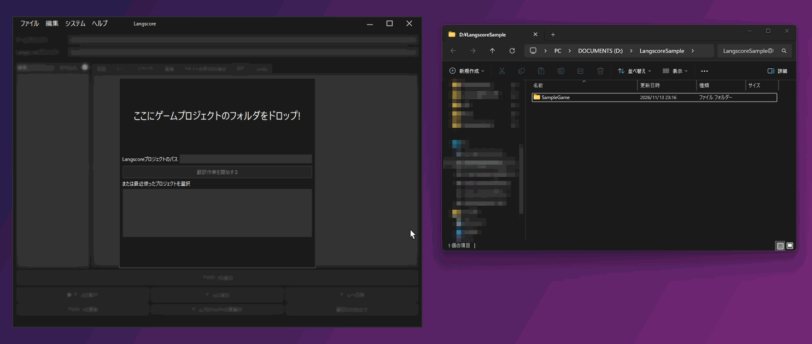
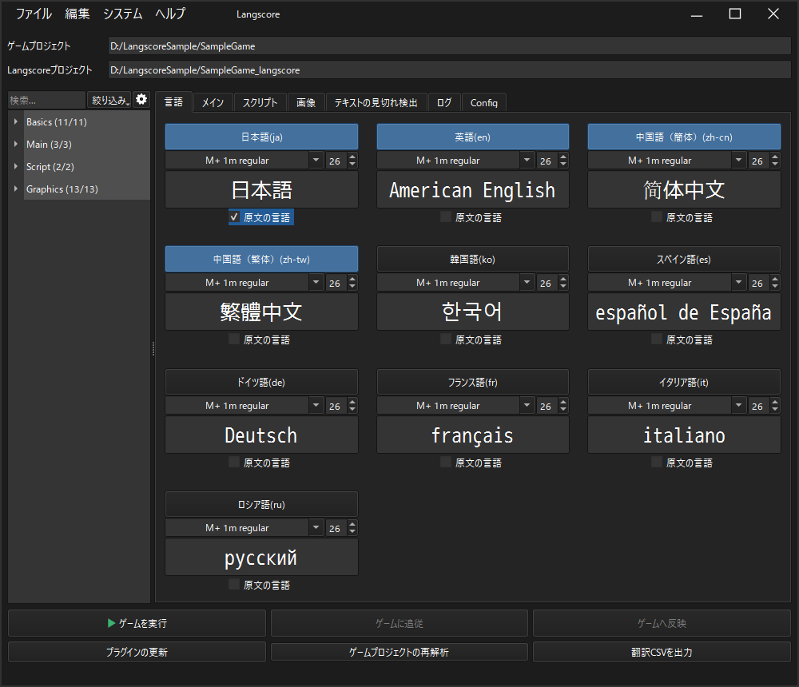
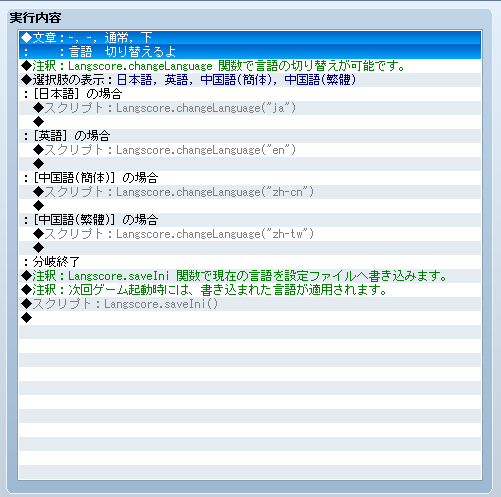
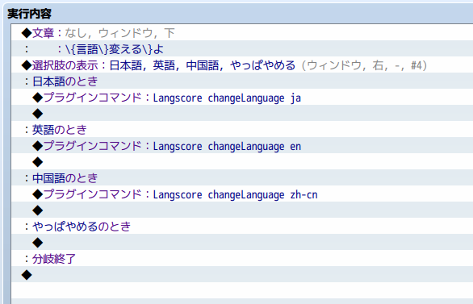

.. _tutorial:

チュートリアル
##############

1. ゲームプロジェクトを解析する
-------------------------------

Langscore.exeを開いて、ゲームプロジェクトの *フォルダ* をドラッグアンドドロップします。

ゲームプロジェクトのフォルダは、rvproj2(VXAce) rpgproject(MV) rmmzproject(MZ) があるフォルダを指します。

「翻訳作業を開始する」ボタンを押すことで、ゲーム内で使用されているテキスト等の解析を始めます。

2. 対応する言語を選ぶ
---------------------------------

正しく解析できた場合、画面が切り替わります。

「言語」タブから、対応したい言語を選択してください。

3. 翻訳を行う
--------------------------------

左のファイルツリーから翻訳対象となるファイルを選び、エディターを表示させます。

原文の内容を元に、空いている箇所を埋めていきます。

4. ゲーム中で言語を切り替える (ゲーム側の作業)
----------------------------------------------

VX Aceの場合
~~~~~~~~~~~~

スクリプト中のLangscore.changeLanguage(lang)関数に、言語文字列を指定して呼び出してください。

また、言語選択メニュークラス"Scene_Language"を用意しています。
こちらも用途に応じてご利用ください。

MV/MZの場合
~~~~~~~~~~~~

プラグインコマンドに Langscore changeLanguage (言語文字列) を指定してください

5. ゲームを実行しながら翻訳する
---------------------------------

プラグインの更新で「リアルタイム編集用プラグインを追加」を選ぶと、ゲームを実行しながら翻訳することが出来ます。

1. 「ゲームを実行」を押します
2. 「ゲームに追従」を押します
3. ゲーム側で文章が表示されると、連動してエディターの該当箇所がハイライトされます。
4. 編集した文章は「ゲームへ反映」を押すと、ゲーム側に反映されます。