.. _screen_description_edit:

基本的な使い方
####################################

解析ダイアログ
--------------

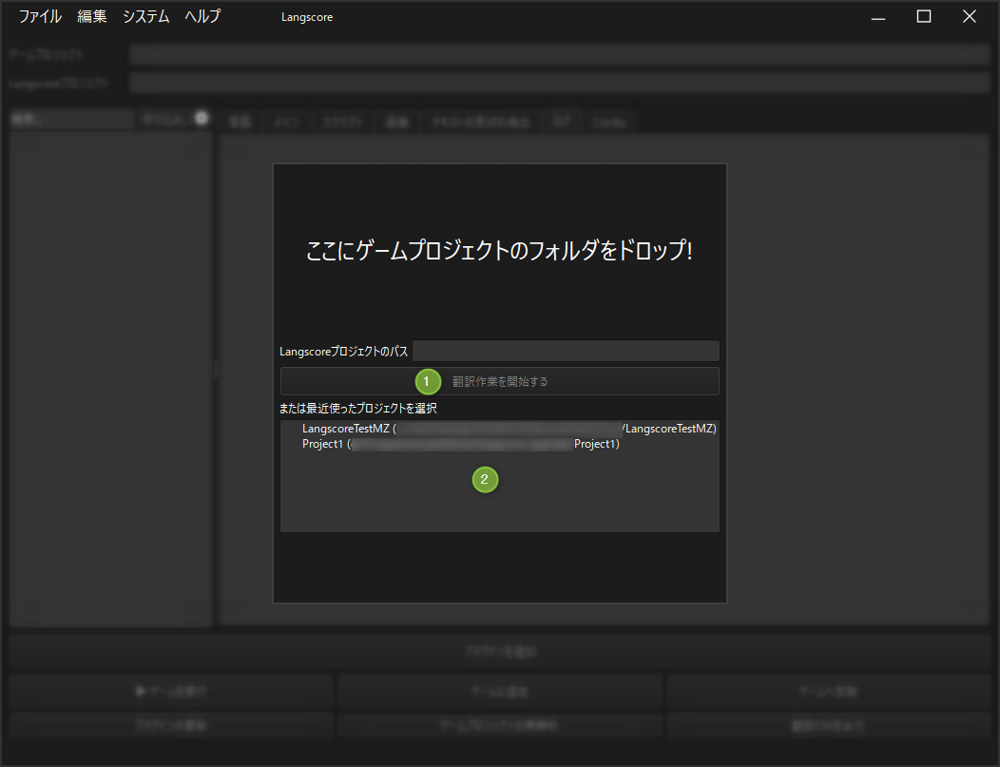

1. 解析ボタン
^^^^^^^^^^^^^^^^^^^^

ゲームプロジェクトフォルダをこの画面にドラッグ＆ドロップしてください。

正しくフォルダを読み込めた場合「Langscoreプロジェクトパス」に出力先のパスが表示されます。

既にプロジェクトが作成済みの場合、翻訳ファイル作成モードに移行します。
   
2. 最近使ったプロジェクト
^^^^^^^^^^^^^^^^^^^^^^^^^

最近使用したプロジェクトの一覧が表示されます。ダブルクリックで読み込みます。

ゲームプロジェクトの初回読み込み時
^^^^^^^^^^^^^^^^^^^^^^^^^^^^^^^^^^

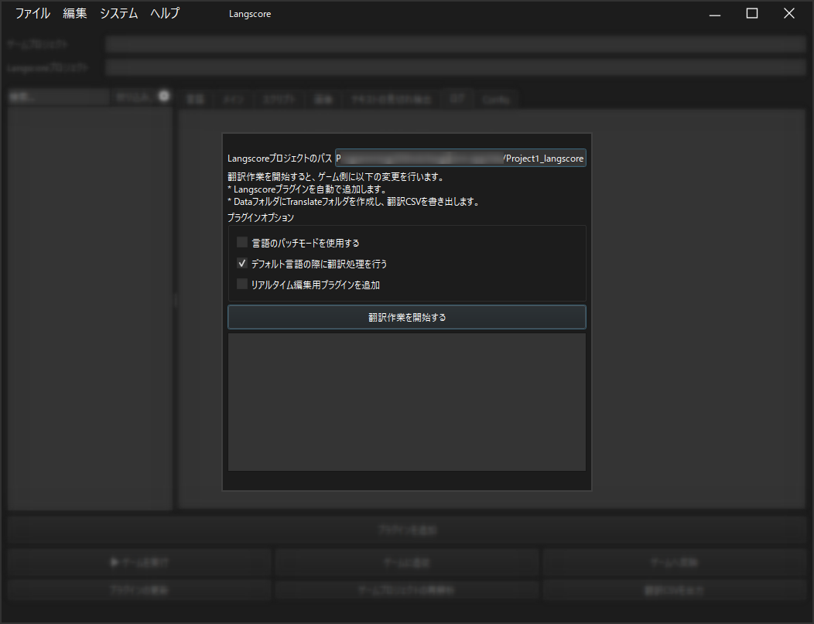

プラグインオプション
~~~~~~~~~~~~~~~~~~~~

言語のパッチモードを使用する
   :ref:`language_patch` を使用する場合はチェックを入れて下さい。

デフォルト言語の際に翻訳処理を行う
   例えば原文が日本語の場合、日本語を選んでいる場合も翻訳の検索処理が行われます。チェックを外すと処理が少しだけ軽くなるかもしれません。

リアルタイム編集用プラグインを追加
   :ref:`realtime_edit` を行う場合にチェックを入れて下さい。このプラグイン(Langscore_RemoteHub)は製品リリース時は削除して下さい。

編集ビュー
----------------------

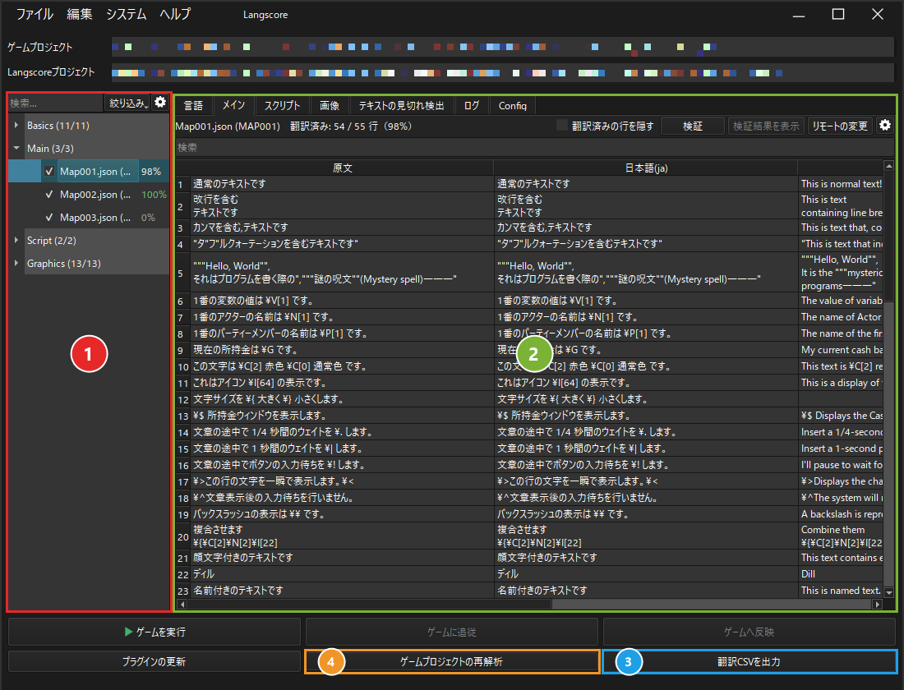

1. 翻訳ファイルツリー
   
   - 翻訳に関わるファイルを一覧できます。
   
   - 項目をクリックすると、その内容を翻訳ファイルプレビューに表示します。
   
   - 左のチェックを外すと、翻訳ファイルを書き出さなくなります。

2. 編集ウィンドウ

   - 5種類のウィンドウを切り替えて表示することが出来ます。(下記参照)

3. 書き出しボタン

   - 翻訳ファイルを書き出し、プラグインを追加します。

   - 一度書き出した場合、ボタンが分離します。

4. 再解析ボタン
 
   - :ref:`reanalysis` を行います。

ゲームの実行・追従・反映ボタン
------------------------------

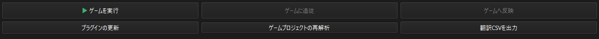

ゲームを実行
   テストプレイを起動します。

ゲームに追従
   テストプレイ中のゲームで表示している文章の行を、表でハイライトします。

ゲームへ反映
   編集した翻訳をゲームの翻訳ファイルに書き出し、実行中のゲームに読み直させます。

「ゲームに追従」「ゲームへ反映」を使うには、ゲームにLangscore_RemoteHubを追加する必要があります。
詳しくは :ref:`realtime_edit` を参照して下さい。

メニュー
--------

ファイル
^^^^^^^^

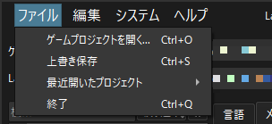

ゲームプロジェクトを開く... (Ctrl+O)
   別のゲームプロジェクトを開きます。解析ダイアログが表示されます。

上書き保存 (Ctrl+S)
   編集した内容をLangscoreプロジェクトに保存し、またゲーム側にも翻訳文を適用します。

最近開いたプロジェクト
   最近開いたプロジェクトを選んで開きます。

終了 (Ctrl+Q)
   Langscoreを終了します。保存していない編集がある場合は、保存するかどうかの確認が表示されます。

編集
^^^^

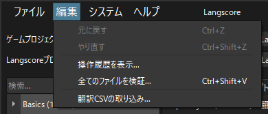

元に戻す (Ctrl+Z)・やり直す (Ctrl+Shift+Z)
   編集を元に戻したり出来ます。

操作履歴を表示...
   これまでの操作の一覧を表示します。

全てのファイルを検証... (Ctrl+Shift+V)
   全てのファイルの翻訳文を検証します。詳しくは :ref:`validation` を参照して下さい。

翻訳CSVの取り込み...
   外部で編集した翻訳CSVを取り込みます。詳しくは :ref:`import_translation_csv` を参照して下さい。

システム
^^^^^^^^

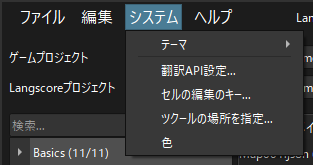

テーマ
   画面の配色を「ライト」「ダーク」「システム」から選びます。「システム」はWindowsの設定に合わせます。

翻訳API設定...
   機械翻訳に使うAPIキーを設定します。詳しくは :ref:`machine_translation` を参照して下さい。

セルの編集のキー...
   表のセルの編集を確定・キャンセルするキーを変更します。詳しくは :ref:`translation_editor` を参照して下さい。

ツクールの場所を指定...
   MV/MZのテストプレイに使う、ツクール本体のフォルダを指定します。詳しくは :ref:`realtime_edit` を参照して下さい。

ヘルプ
^^^^^^

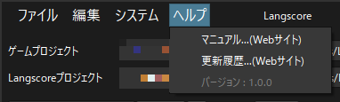

マニュアル...(Webサイト)
   このマニュアルをブラウザで開きます。

更新履歴...(Webサイト)
   :ref:`history` をブラウザで開きます。

バージョン
   使用しているLangscoreのバージョンが表示されます。

ファイルツリーの検索と表示設定
------------------------------

ファイルツリーの上にある検索バーに文字を入力すると、ファイル名で絞り込めます。

検索バーの右の歯車ボタンから、表示の設定を変更できます。

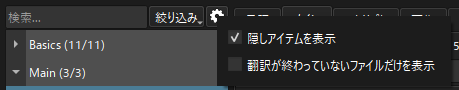

隠しアイテムを表示
   非表示にしたアイテムも表示します。

翻訳が終わっていないファイルだけを表示
   翻訳済みの割合が100%になっていないファイルだけを表示します。

ファイルツリーの項目を右クリックし、「アイテムを非表示」を選ぶと、その項目をツリーから隠せます。

隠した項目は「隠しアイテムを表示」で表示し、右クリックの「アイテムを表示」で元に戻せます。

各項目の右側には、翻訳済みの行の割合が表示されます。マウスを乗せると「翻訳済み: 54 / 55 行」のように行数を確認できます。

「絞り込み」ボタンではツリーに表示する検証結果を絞り込むことが出来ます。

情報ウィンドウの種類
--------------------

言語
^^^^

翻訳対象の言語を選択することが出来ます。

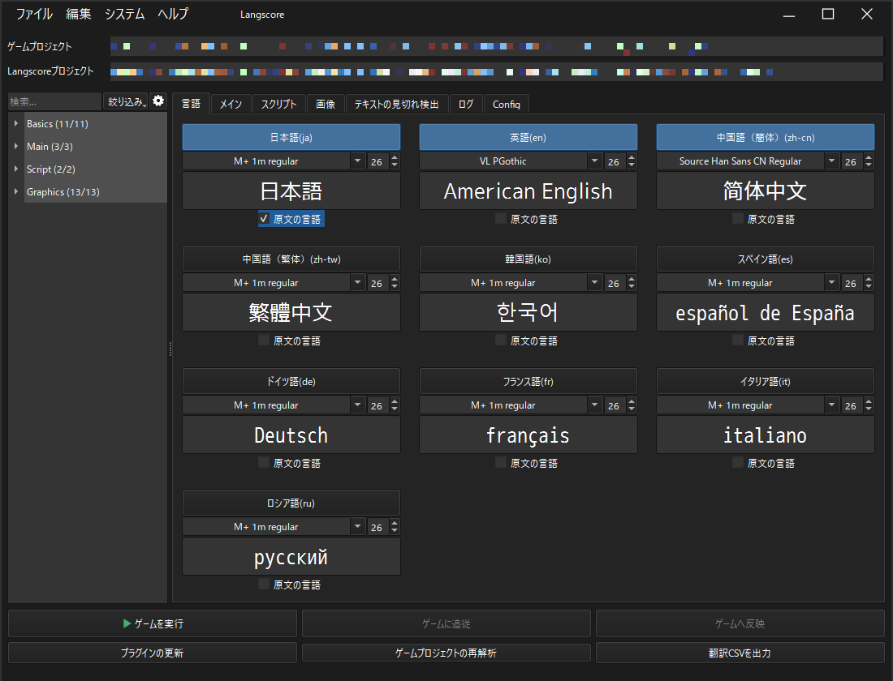

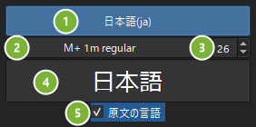

1. 言語の有効無効ボタン
2. ゲームで使用するフォント
3. フォントサイズ
4. フォントの簡易プレビュー
5. 原文の言語チェック

.. attention:: 原文の言語チェックは、必ずゲーム制作時に使用した言語を選択してください。  
   この設定は原文が何語かを判定する際に使用しているため、異なる言語にチェックを付けると正しく翻訳されない可能性があります。

Main
^^^^

選択したデータ内の文章を確認することが出来ます。
マップのデータやデータベース情報といった内容がMainに分類されます。

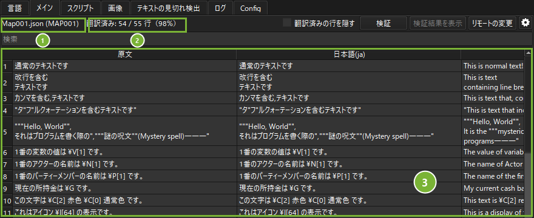

1. 選択したデータ名
2. 文章の内容

スクリプト
^^^^^^^^^^

スクリプト(プラグイン)に含まれるテキストが含まれます。

* VX Ace
 
  - 戦闘中のバフ・デバフテキストやショップのテキストはここに含まれます。

* MV/MZ
 
  - プラグインスクリプト内のテキストに加え、プラグインパラメータ内のテキストも含まれます。

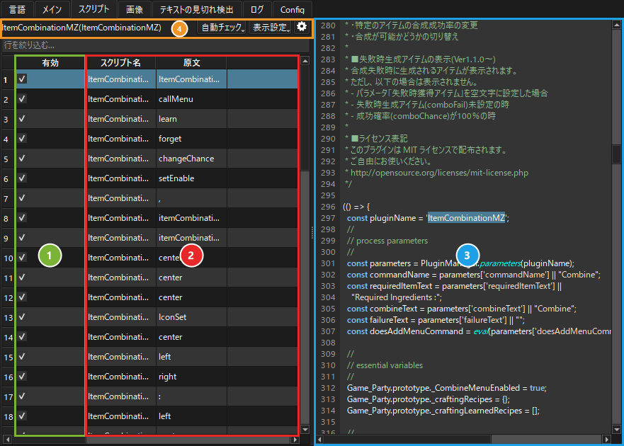

1. 翻訳に含めるかのチェック

   - チェックを外すとlangscore_customに情報が書き出されなくなります。

2. スクリプト名と内容

3. 簡易スクリプトプレビュー

4. 情報・メニュー欄

   * 選択した行のスクリプト名
   * 自動チェックメニュー
   * 表示フィルターメニュー

.. _screen-auto-check-menu_edit:

自動チェックメニュー
~~~~~~~~~~~~~~~~~~~~~~~~~~

* 記号のみのテキストのチェックを外す

  - "Original Text" 列を検索し、 , や :: といった記号 **しか無い** 行のチェックを外します。

* 日本語を含まない文章のチェックを外す

  - "Original Text" 列を検索し、 日本語(ひらがな・カタカナ・漢字)を **含まない** 行のチェックを外します。

表示フィルターメニュー
~~~~~~~~~~~~~~~~~~~~~~~~~~~~

* 全ての内容を表示

  - 全ての内容が表示されます。

* 無視にした内容を非表示

  - Include列のチェックが外れている行が非表示になります。

画像
^^^^

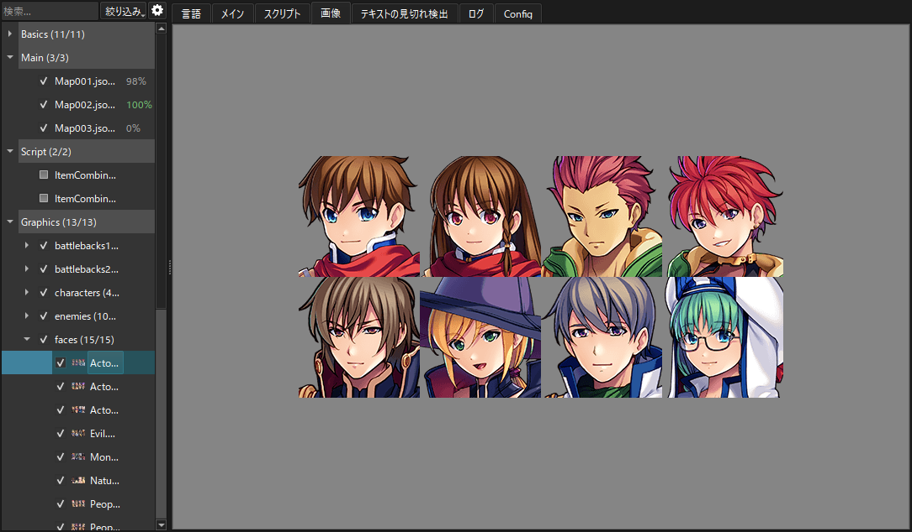

ツリーで選んだ画像がプレビュー表示されます。

翻訳対象に含める際の確認にご利用ください。

ログ
^^^^

書き出し時のログを雑に出力しています。

不具合等があった場合、このログを頂けると大変助かります。

.. _text_clip_detect:

見切れ検出
----------

テキストの表示がウィンドウ内に収まっているかを判定する機能です。

設定場所
^^^^^^^^

見切れ検出の設定は、情報ウィンドウの「テキストの見切れ検出」タブで行います。

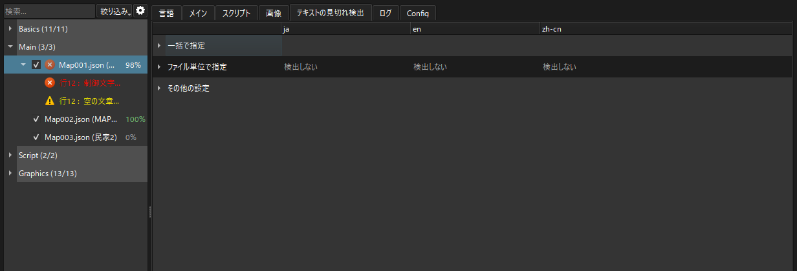

検出の結果は、 :ref:`validation` で確認できます。

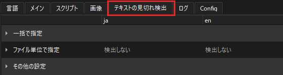

検出の種類
^^^^^^^^^^

見切れ検出には2種類の方法があります。どちらも検出する長さを指定します。

(検出長 < 文章長) で警告となります。

文章数
~~~~~~

文字数を指定し、その文字数を超えた場合に警告を出します。

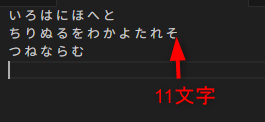

画像の文章の場合、10を指定すると警告が出ます。

文章の表示長
~~~~~~~~~~~~

文章の横幅における最大ピクセル数を指定し、その長さを超えた場合に警告を出します。
フォントは各種言語で指定したフォントに準拠します。

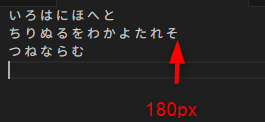

画像の文章の場合、179を指定すると警告が出ます。

検出対象
~~~~~~~~

検出する文章のカテゴリが7種類あります。

バトルメッセージ
""""""""""""""""

戦闘中に表示されるメッセージ（〇〇の攻撃！）です。

battleName
""""""""""

戦闘中に表示されるキャラ名などです。英語になっているのは多分ミスです。

説明文
""""""

アイテムや武器防具の説明文です。

文章
""""

会話テキストが該当します。

アイコン付き文章
""""""""""""""""
アイコンが付いている場合の文章です。

検出する長さには、文章が表示される右端から左端までの長さを計測して設定して下さい。

名前
""""
メニューなどに表示されるキャラ名です。

その他
""""""
分類出来なかった内容がその他として格納されます。

設定方法
^^^^^^^^

「ファイル単位で指定」または「一括で指定」で指定可能です。

ファイル単位で指定
~~~~~~~~~~~~~~~~~~

翻訳CSV毎に設定を行います。

ファイルは「翻訳ファイルが有るフォルダ」で指定したフォルダ内のファイルが表示されます。

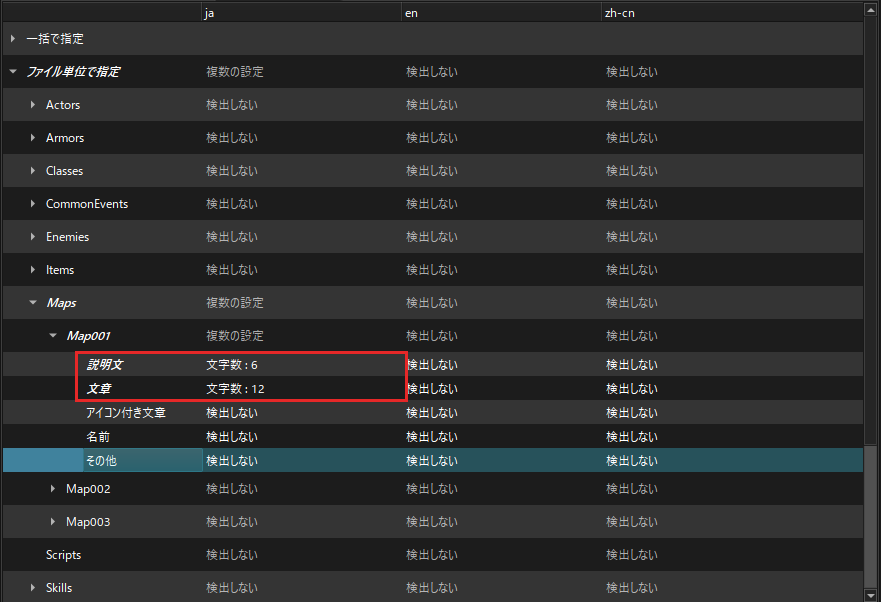

一括で指定
~~~~~~~~~~

検出対象毎に検出設定を適用します。同じ検出対象を持つ全てのファイルに影響します。

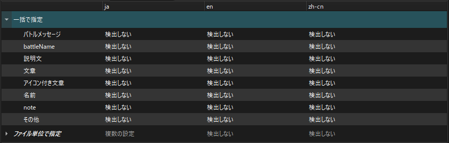

その他の設定
^^^^^^^^^^^^

ツクールの制御文字を使用している文章の場合、制御文字を考慮して長さの検出を行います。

しかし、プラグインによっては独自の制御文字を使用しているものもあるため、それらのプラグインを使用している場合にこの設定を変更します。

枠で括った辺りをクリックすると、制御文字入力UIが表示されます。

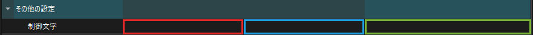

↓

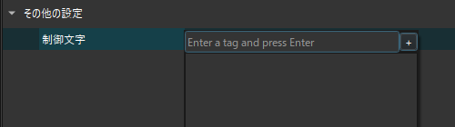

"Enter a tag and press Enter"に制御文字を入力して、+ボタンを押して下さい。"\" は不要です。

また、"[]"が含まれる場合は"〇〇["と入力して下さい。

例えば\set[]という制御文字の場合は"set["と入力します。

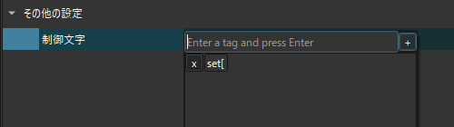

削除する場合はxボタンを押して下さい。テキストの編集も可能です。

.. _reanalysis:

再解析
------------------

現在のゲームプロジェクトの再解析を行います。

ゲーム内の文章を修正したり、新規に文章を追加した場合は必ず再解析を行って下さい。

再解析後に書き出しを行うことで、最新の内容が翻訳CSVに反映されます。

.. admonition:: 注意
   :class: warning
   
   テキストの修正や削除を行っても、CSVには修正前や削除したテキストが残り続けます。

   翻訳処理には問題ありませんが、不要な場合は手動で削除して下さい。

書き出しダイアログ
------------------

プラグインの更新 (2回目以降)
^^^^^^^^^^^^^^^^^^^^^^^^^^^^^^^^^^

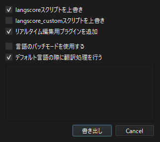

   
* 言語パッチモードを使用する

  - :ref:`言語パッチ機能 <language_patch>` を有効にします。

* デフォルト言語の際に翻訳処理を行う

  - チェックを外すと、デフォルト言語使用時は翻訳処理を ``行いません`` 。
   
* langscoreスクリプトを上書き

  - プラグインを更新します。バージョンを上げる場合に使用して下さい。

* langscore_customスクリプトを上書き

  - langscore_customを上書きします。既に書き込んでいる場合、内容が初期化されますので注意して下さい。

* リアルタイム編集用プラグインを追加

  - :ref:`realtime_edit` 用のプラグイン Langscore_RemoteHub をゲームに追加します。

  - テストプレイ中にだけ動作しますが、ゲームをリリースする際は必ず取り除いて下さい。

.. _update_csv_second:

翻訳CSVの更新 (2回目以降)
^^^^^^^^^^^^^^^^^^^^^^^^^^^

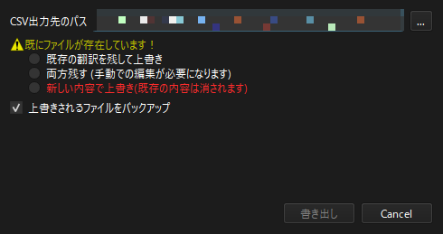

* 上書きされるファイルをバックアップ

  - 既存の翻訳CSVファイルのバックアップを取ります。

上書き確認について
^^^^^^^^^^^^^^^^^^

書き出し先にCSVが存在する場合、上書きの確認を行わないと書き出すことが出来ません。

既存の翻訳を残して上書き
~~~~~~~~~~~~~~~~~~~~~~~~~~~~~~~~

翻訳された文章がある行は何も変更しません。
また、翻訳CSVに無いテキストは新しい行で書き出されます。

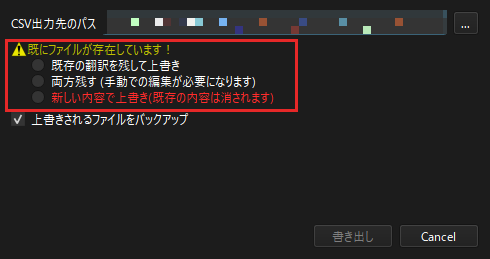

   
バックアップについて
^^^^^^^^^^^^^^^^^^^^^^^^^

有効にした場合、以下のファイル・フォルダを"(プロジェクト名)_langscore/backup"に保存します。

- Script.rvdata ファイル
- Translateフォルダ (翻訳書き出し後に作成)

バックアップフォルダは日時を付与するため、バックアップ同士で上書かれることはありません。

制限なく書き出して自動削除もしていませんので、不要な場合は折を見て手動で削除してください。
