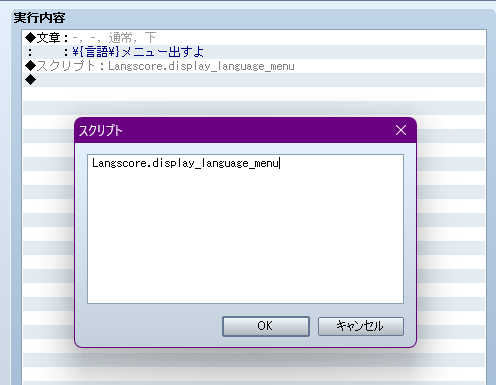
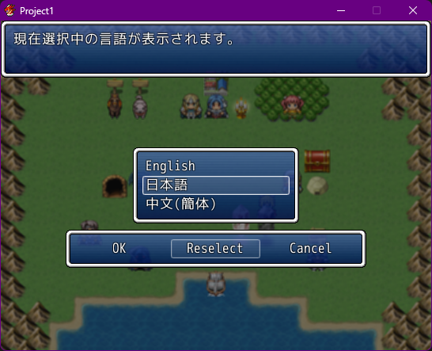
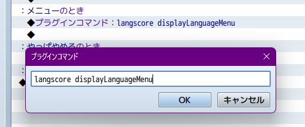
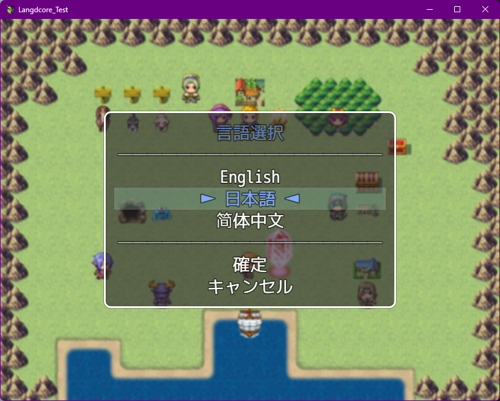
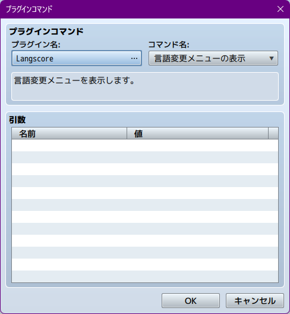
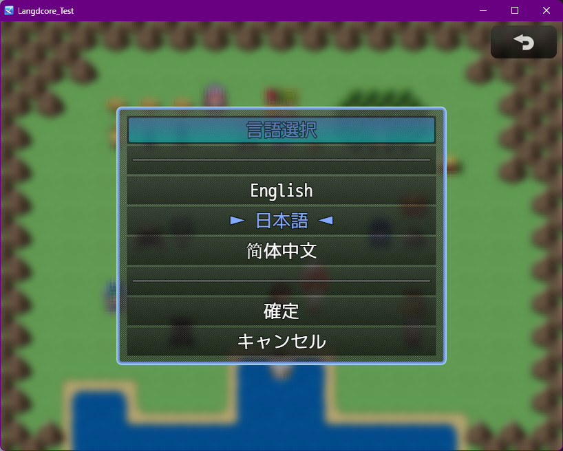
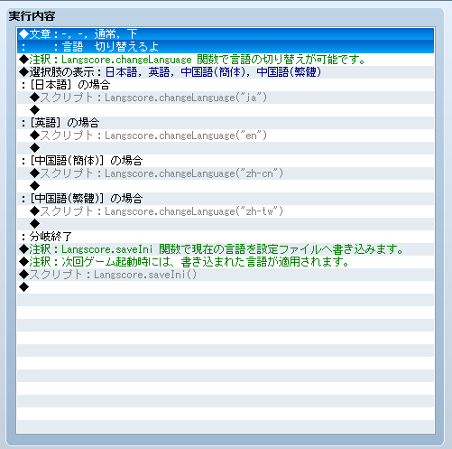
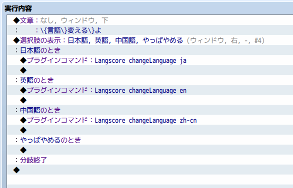

.. _language_menu:

言語選択メニュー
########################################

:ref:`言語パッチ機能について <language_patch>` の対応に合わせて、プラグイン内で簡易的な言語選択メニューを用意しました。

パッチモードを使用している場合、言語フォルダが見つかったもののみ表示されます。

言語選択メニューを表示する
**************************

VXAce
------

スクリプトの呼び出しで ``Langscore.display_language_menu`` を呼び出します。
    

MV
------

プラグインコマンドで ``langscore displayLanguageMenu`` を呼び出します。
    

MZ
------

プラグインコマンドから Langscore | 言語変更メニュー を呼び出します。
    

.. _change_language:

メニューを使わずに言語を切り替える
**********************************

VX Aceの場合
------------

スクリプト中のLangscore.changeLanguage(lang)関数に、言語文字列を指定して呼び出してください。

また、言語選択メニュークラス"Scene_Language"を用意しています。
こちらも用途に応じてご利用ください。

MV/MZの場合
-----------

プラグインコマンドに Langscore changeLanguage (言語文字列) を指定してください

