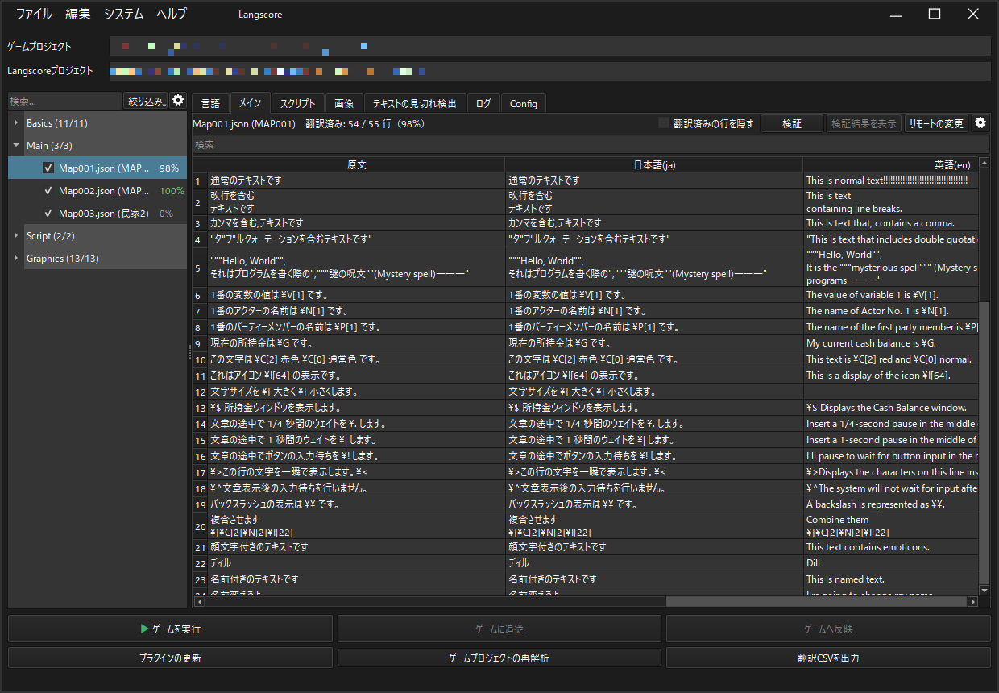
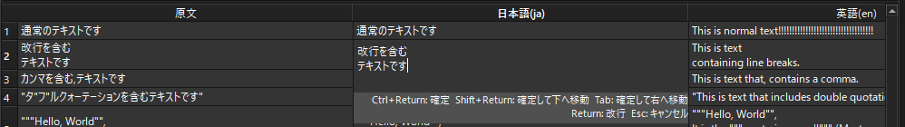
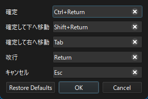
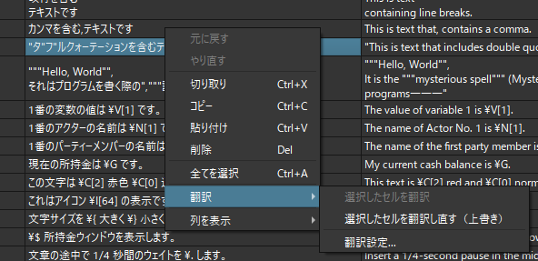
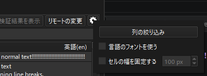
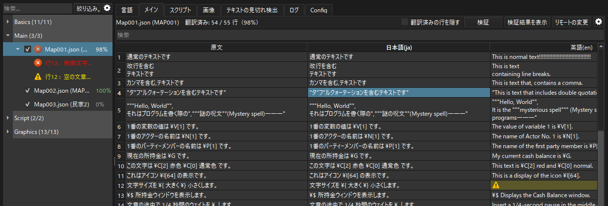
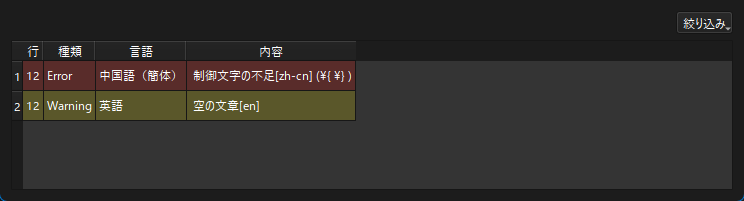

.. _translation_editor:

翻訳の編集
########################################

Langscore上で翻訳文を直接編集できます。

ExcelなどでCSVを開かなくても、翻訳作業をLangscoreの中で完結させることができます。

表の見かた
**********

左のファイルツリーでファイルを選ぶと、「メイン」タブに翻訳の表が表示されます。

.. list-table::
   :header-rows: 1
   :widths: 20 60

   * - 列
     - 内容
   * - 原文
     - ゲームに書かれている文章です。編集できません。
   * - 言語の列
     - 各言語の翻訳文です。ここを編集します。
   * - 種類
     - 文章の種類。編集できません。

スクリプトのテキストは「スクリプト」タブに表示されます。

セルの編集
**********

セルをダブルクリックするか、セルを選んで文字を入力するとテキストボックスが表示されます。

編集中のセルの下には、確定やキャンセルに使うキーが表示されます。

セルの編集のキー
================

編集を確定・キャンセルするキーは、メニューの「システム」→「セルの編集のキー...」で変更できます。

.. list-table::
   :header-rows: 1
   :widths: 30 30

   * - 動作
     - 既定のキー
   * - 確定
     - Ctrl+Enter
   * - 確定して下へ移動
     - Shift+Enter
   * - 確定して右へ移動
     - Tab
   * - 改行
     - Enter
   * - キャンセル
     - Esc

同じキーを複数の動作に割り当てることはできません。
「Restore Defaults」で既定のキーに戻せます。

切り取り・コピー・貼り付け
==========================

セルを右クリックすると、切り取り・コピー・貼り付けなどのメニューが表示されます。

* 複数のセルをまとめてコピー・貼り付けできます。
* 複数セルを貼り付けた際にエディターからはみ出した場合、はみ出した部分のセルは貼り付けられません。
* 原文・種類などの編集できない列には貼り付けられません。

表示設定
********

エディターの右上の歯車ボタンから、表示の設定を変更できます。

列の絞り込み
   表示する言語の列を選びます。

言語のフォントを使う
   各言語列のセルに言語タブで指定したフォントを適用します。

セルの幅を固定する
   セルの幅を指定したピクセル数に固定します。

翻訳済みの行を隠す
   すべての言語が埋まっている行を隠し、翻訳が残っている行だけを表示します。

検索
   入力した文字を含む行だけを表示します。

翻訳の進捗
**********

ファイルごとの翻訳の進捗は、ファイルツリーの右側に割合で表示されます。
また、エディターの上部には「翻訳済み: 54 / 55 行（98%）」のように、翻訳済みの行数が表示されます。

※翻訳済みの行とは、有効にしたすべての言語の翻訳文が埋まっている行のことです。

保存と書き出し
**************

編集した翻訳文は、「ファイル」→「上書き保存」(Ctrl+S)でLangscoreプロジェクトとゲーム側に保存されます。

.. note:: VX Aceの場合、書き出しと同時にパッキングも自動で行われます。

保存せずにプロジェクトを閉じようとすると、保存するかどうかの確認が表示されます。
「いいえ」を選ぶと、編集した内容は破棄されます。

.. _validation:

検証
****

翻訳文に問題が無いかを確認する機能です。

* エディターの上の「検証」ボタンで、表示中のファイルを検証します。検証の前に、表示中のファイルの編集はプロジェクトに保存されます。
* メニューの「編集」→「全てのファイルを検証...」(Ctrl+Shift+V)で、全てのファイルを検証します。

問題が見つかった行は、ファイルツリーとエディターに表示されます。
ファイルツリーの項目をクリックすると、該当する行へ移動します。

「検証結果を表示」を押すと、結果の一覧が表示されます。
「絞り込み」でエラーだけ・警告だけを表示することもできます。

F8キーで次のエラーへ、Shift+F8キーで前のエラーへ移動できます。

検出する内容
============

.. list-table::
   :header-rows: 1
   :widths: 30 60

   * - 内容
     - 説明
   * - 空の文章
     - 翻訳文が入力されていません。
   * - 制御文字の不足
     - 原文にある制御文字（\\V[1] など）が、翻訳文にありません。
   * - 制御文字の閉じ忘れ
     - 制御文字の括弧が閉じられていません。
   * - 改行文字
     - 改行文字 \\r\\n が含まれています。
   * - 言語の不一致
     - 指定した言語と、翻訳文の言語が一致していません。
   * - 見切れ
     - 文章がウィンドウからはみ出しています。 :ref:`text_clip_detect` の設定が必要です。
   * - 文字数超過
     - 指定した文字数を超えています。 :ref:`text_clip_detect` の設定が必要です。
   * - 無効なCSV
     - CSVの形式が壊れています。エラーに表示された行の辺りを確認して下さい。

.. note:: 検証の結果は、修正のためのヒントです。意図して書いた箇所であれば、そのままにしても書き出しには影響しません。

.. _import_translation_csv:

翻訳CSVの取り込み
*****************

翻訳者にCSVを渡してExcelなどで編集してもらった場合、その内容をLangscoreに取り込むことができます。

1. メニューの「編集」→「翻訳CSVの取り込み...」を選びます。
2. 取り込む翻訳CSVを選びます。複数のファイルを一度に選べます。
3. 取り込んだ翻訳の数が表示されます。
4. 「ファイル」→「上書き保存」でプロジェクトに保存します。

ファイル名が一致するものに取り込まれます。例えば ``Map001.csv`` は、ファイルツリーの Map001 に取り込まれます。

取り込まれない内容
==================

* 原文がプロジェクトの原文と一致しない行
* 空のセル
* プロジェクトで有効になっていない言語の列
* プロジェクトに同じ名前のファイルが無いCSV

