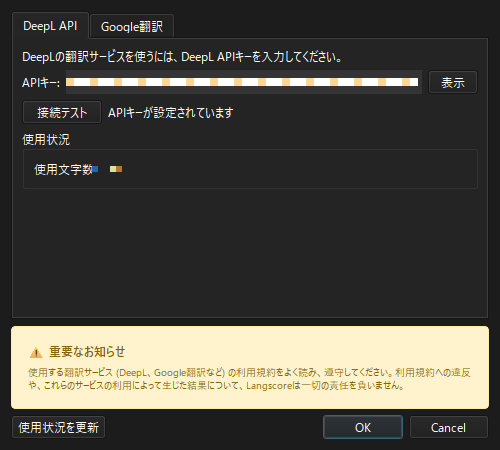
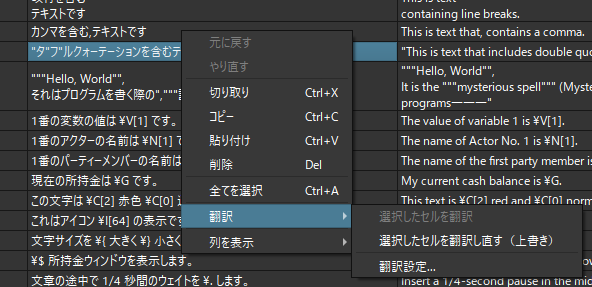

.. _machine_translation:

機械翻訳
########################################

翻訳サービスのAPIを使って、エディターのセルを機械翻訳できます。

対応しているサービスは次の2つです。

* DeepL API
* Google翻訳（Cloud Translation API）

APIの利用には、各サービスでのアカウント登録とAPIキーの発行が必要です。

APIキーの設定
*************

1. メニューの「システム」→「翻訳API設定...」を開きます。
2. 使うサービスのタブを選び、APIキーを入力します。
3. 「接続テスト」を押して、「接続に成功しました」と表示されることを確認します。
4. 「OK」を押して閉じます。

ダイアログ左下の「使用状況を更新」を押すと、DeepL APIで使った文字数を確認できます。

.. note:: DeepLとGoogle翻訳の両方にAPIキーを入力した場合は、DeepLを優先的に使用します。

セルを翻訳する
**************

翻訳したいセルを選んで右クリックし、「翻訳」メニューから選びます。
複数のセルをまとめて選べます。

空のセルを翻訳
   選んだセルのうち、空のセルだけを翻訳します。メニューには「〇個の空のセルを翻訳」と表示されます。
   既に翻訳文が入っているセルは変更しません。

選択したセルを翻訳し直す（上書き）
   選んだセルを、翻訳文が入っていても翻訳し直します。
   実行前に、上書きするセルの数が表示されます。

翻訳設定...
   「翻訳API設定」を開きます。

翻訳には原文列の内容が使用されます。
またデフォルト言語と同じ言語の列を選んでいる場合は、翻訳を続けるかどうかを確認します。

翻訳中の操作
**********************

* 「キャンセル」を押すと翻訳を中止します。翻訳済みの内容は保存されますが、キャンセルした後の残りのセルは翻訳されません。
* 一部の翻訳に失敗した場合は、失敗した件数とエラーの内容が表示されます。
* 翻訳が正しく適用できなくなるため、翻訳中に別のファイルへは切り替えないで下さい。

利用規約について
****************

.. attention:: 使用する翻訳サービス（DeepL、Google翻訳など）の利用規約は熟読して下さい。

   利用規約への違反や、これらのサービスの利用によって生じた結果について、Langscoreは一切の責任を負いません。

また、APIの利用料金は各サービスの料金体系に従います。機会翻訳する際は使用状況や料金をご確認下さい。
