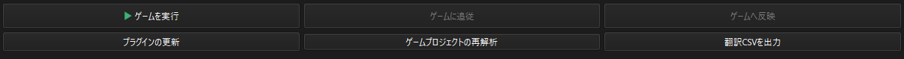
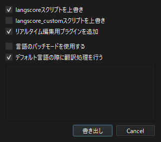
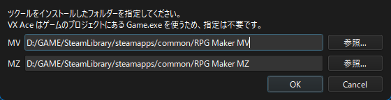

.. _realtime_edit:

リアルタイム編集
########################################

テストプレイ中のゲームとLangscoreを連携させる機能です。

ゲームで表示している文章の行をエディターで確認しながら翻訳し、編集した翻訳を即時反映することができます。
実際の画面で確認しながら翻訳したい場合や、翻訳漏れのチェックにご利用下さい。

ゲームを実行
   テストプレイを起動します。(ツクールから起動する時と同じ方法で起動します。)

ゲームに追従
   ゲームと接続し、表示中の内容をエディターでハイライトできるようにします。

ゲームへ反映
   編集した翻訳をゲームに反映します。

準備
****

リアルタイム編集には、ゲームにプラグイン「Langscore_RemoteHub」を追加する必要があります。
追加する方法は2つあります。

* ゲームプロジェクトを初めて読み込むとき、プラグインオプションの「リアルタイム編集用プラグインを追加」にチェックを入れます。
* 「プラグインの更新」から「リアルタイム編集用プラグインを追加」にチェックを入れて「書き出し」を押します。

MV/MZの場合、プラグイン管理でLangscore_RemoteHubがLangscoreより下に置かれている必要があります。

ゲームを実行
************

「ゲームを実行」を押すと、テストプレイが起動します。

未保存の編集がある場合は、書き出すかを確認します。

書き出して実行
   翻訳CSVを書き出してから、テストプレイを起動します。

書き出さずに実行
   書き出さずにテストプレイを起動します。ゲームでは前回書き出した翻訳が使われます。

ツクールの場所を指定
====================

MV/MZのテストプレイには、ツクール本体の「フォルダ」を設定する必要があります。
未設定の場合、「ゲームを実行」を押したときにツクールをインストールしたフォルダを指定するダイアログが表示されます。

後から変更する場合は、メニューの「システム」→「ツクールの場所を指定...」を開いて下さい。

※VX Aceはゲームのプロジェクトにある Game.exe を使うため、指定は不要です。

ゲームに追従
************

テストプレイ中に「ゲームに追従」を押すと、ゲームと接続します。
接続すると、ボタンの表示が「接続しました。」に変わります。もう一度押すと切断します。

接続中は、ゲームで文章が表示されるたびにその文章がハイライトされます。

.. note:: 追従中は、言語タブで言語を変更できません。言語を変更する場合は、先に切断して下さい。

「ゲームに追従」ボタンが押せない、または「実行中のゲームが見つかりません」と表示される場合は、Langscore_RemoteHubが追加されているか、テストプレイで起動しているかを確認して下さい。

ゲームへ反映
************

翻訳を編集したら「ゲームへ反映」を押します。

実行中のゲームは、翻訳ファイルが変わったことを検知して翻訳を再読込します。

* 各文章は、次に表示されるタイミングで更新されます。(表示中の文章が切り替わるわけではありません)

.. note:: 一度も「翻訳CSVを出力」をしていないプロジェクトでは、先に翻訳CSVを書き出して下さい。

リリース時の注意
****************

.. attention:: Langscore_RemoteHubはテストプレイ中にだけ動作し、通常のプレイでは何もしません。

   ただしデバッグ用のプラグインのため、ゲームをリリースする際は必ずゲームから取り除いて下さい。

取り除く方法は :ref:`uninstall` を参照して下さい。
