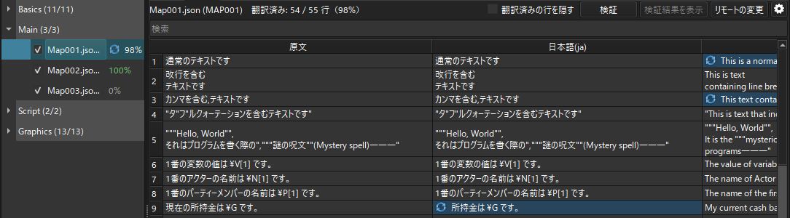
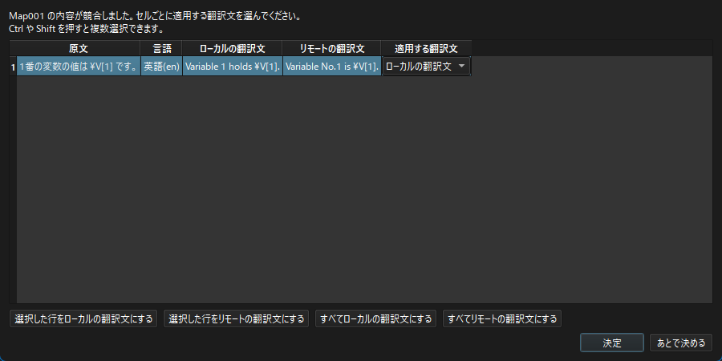
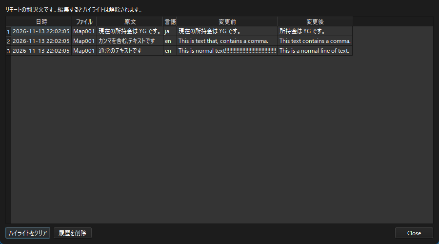

.. _shared_editing:

複数人の共同編集
########################################

Langscoreプロジェクトを共有することで、複数人で翻訳作業を行うことが出来ます。

共有する方法には2種類あります。

共有フォルダ
   クラウドストレージなどの共有フォルダにプロジェクトを置きます。保存した内容は自動で同期されます。手軽に始めたい場合に向いています。

Git
   プロジェクトをGitリポジトリで管理します。Gitを扱える場合に向いています。

どちらの方法でも、他の人が保存した翻訳は自動で取り込まれます。

この説明では、自分のPCで編集した内容を「ローカル」、他の人が保存した内容を「リモート」と呼びます。

共有フォルダで共同編集する
**************************

準備
====

1. ゲームプロジェクトのフォルダと「(プロジェクト名)_langscore」フォルダを、同じ構成のまま共有フォルダに置きます。
   - (ゲームプロジェクト) 
   - (ゲームプロジェクト)_langscore
   - が並ぶ構成です。
2. 各自のPCでLangscoreプロジェクトを開きます。

.. note:: 共有フォルダには、Googleドライブ・OneDrive・Dropboxなど、PC上のフォルダとして同期できるものを使って下さい。

編集した内容はこまめに保存することで、競合したときの確認量が少なく済みます。

Gitで共同編集する
*****************

準備
====

「(プロジェクト名)_langscore」フォルダをGitリポジトリで管理します。
ゲームプロジェクトと同じリポジトリにまとめても構いません。

翻訳文は「(プロジェクト名)_langscore/editing」フォルダのCSVに保存されます。
このフォルダと config.json をコミットして下さい。

なお次のファイル・フォルダは ``.gitignore`` で除外することをお勧めします。

.. code-block:: text

   (プロジェクト名)_langscore/backup/
   (プロジェクト名)_langscore/remote/
   (プロジェクト名)_langscore/log.txt

.. note:: 競合を正しく解決するために、各自のPCにGitをインストールし、コマンドプロンプトなどから ``git`` を実行できる状態にしておいて下さい。

作業の流れ
==========

1. Langscoreで翻訳を編集し、「上書き保存」(Ctrl+S)で保存します。
2. 保存した内容をコミットし、プッシュします。
3. 他の人の変更は、プル（またはマージ）で取り込みます。

Langscoreを開いたままプルしても構いません。
プルで翻訳CSVが更新されると、その内容が取り込まれます。

.. attention:: プルの前に、Langscoreで「上書き保存」をして下さい。保存していと競合しているかを正しく検出できません。

Gitで競合した場合
=================

プルやマージで翻訳CSVが競合した場合、CSVの中に競合マーカー（ ``<<<<<<<`` など）が書き込まれます。
Langscore側で競合マーカーを読み込んで解決することが出来ます。

1. 競合したファイルをLangscoreで開きます。Langscoreを開いたままプルした場合は、そのまま待ちます。
2. 競合したセルがある場合 :ref:`「編集の競合」ダイアログ <edit_conflict>` が表示されます。セルごとに使う翻訳文を選び、「決定」を押します。
3. 「上書き保存」で保存します。保存すると、CSVから競合マーカーが消えます。
4. 解決したCSVを ``git add`` し、コミットしてマージを完了させます。

.. note:: ``git`` を実行できない環境では、CSVの競合マーカーから両側の内容を読み取ります。
   翻訳文に「=======」だけの行があるなど、競合マーカーと見分けが付かない場合は正しく読み取れないことがあります。

.. note:: Langscoreのアプリ上で解決できるのは、editing フォルダの翻訳CSVの競合だけです。
   config.json など他のファイルが競合した場合は、通常の手順で解決して下さい。

リモートの変更の取り込み
************************

共有フォルダの同期やGitのプルで更新された翻訳は、自動で表に取り込まれます。

* 翻訳文が取り込まれたセルはハイライトされます。セルのホバーで変更前の翻訳文を確認できます。
* ハイライトされたセルを編集すると、ハイライトは解除されます。
* また翻訳文を取り込んだファイルには、ファイルツリーにアイコンが表示されます。

.. _edit_conflict:

編集の競合
**********

自分が編集して未保存のセルに対し、同じセルを他の人が変更した場合や、Gitで翻訳CSVが競合した場合は、「編集の競合」ダイアログが表示されます。

セルごとに、ローカルの翻訳文とリモートの翻訳文のどちらを使うかを「適用する翻訳文」で選んで下さい。

選択した行をローカルの翻訳文にする・選択した行をリモートの翻訳文にする
   選んだ行の翻訳文を切り替えます。Ctrl や Shift を押すと複数の行を選べます。

すべてローカルの翻訳文にする・すべてリモートの翻訳文にする
   全ての行をまとめて切り替えます。

選び終わったら「決定」を押します。

「あとで決める」を押すと、競合を残したままダイアログを閉じます。
競合が残っているファイルは、ファイルツリーに「?」のアイコンが表示され、次にファイルを表示した際に再度確認されます。

リモートの変更の履歴
********************

表の上の「リモートの変更」を押すと、取り込んだリモートの変更の履歴が表示されます。

履歴には、取り込んだ日時・ファイル・原文・言語・変更前と変更後の翻訳文が表示されます。

ハイライトをクリア
   全てのファイルで、リモートの翻訳文を取り込んだセルのハイライトを消します。

履歴を削除
   リモートの変更の履歴を削除します。

.. note:: 履歴は各PCのLangscoreのフォルダに保存されます。他の人とは共有されません。
